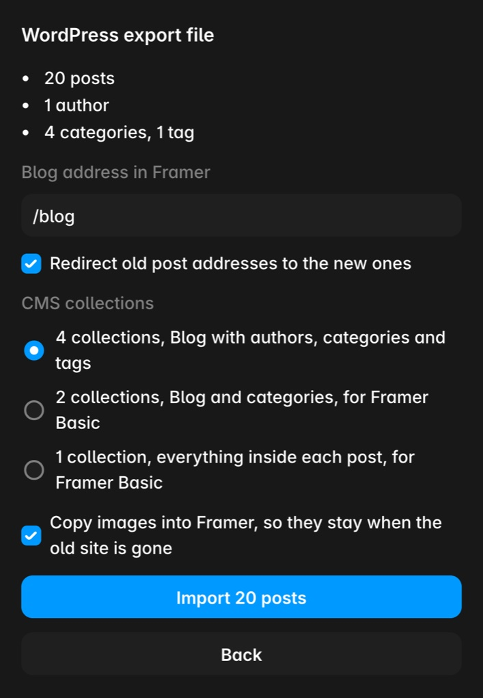

# Migrer un blog WordPress vers Framer

WordPress offre deux façons de sortir vos articles : le fichier d'export ou le site en ligne. Le choix change ce que vous récupérez.

La voie courte : [Blog Import sur le Framer Marketplace](https://www.framer.com/marketplace/plugins/blog-import-squarespace-wordpress/), notre plugin qui lit l'export WordPress, copie les images dans Framer et ajoute les redirections. Vos 25 articles les plus récents s'importent gratuitement. Dans votre projet, partez du CMS : onglet Plugins, Blog Import, Create. Le plugin est en anglais ; la suite de cette page explique chaque étape.

## Option 1 : le fichier d'export

Dans le tableau de bord WordPress, ouvrez Outils, puis Exporter, choisissez Tout le contenu et téléchargez le fichier `.xml`. Il contient tous les articles, brouillons compris, avec auteurs, catégories et étiquettes.

Ce que le fichier ne contient pas, c'est l'article tel que vos lecteurs le voient. WordPress stocke le texte brut et le met en forme à chaque affichage. Sur les données de test officielles de WordPress (58 articles conçus pour tester la mise en forme) :

- 35 articles sur 58 n'avaient aucune balise de paragraphe. WordPress les ajoute à l'affichage ; importé tel quel, chaque article devient un seul bloc de texte.
- Les légendes, galeries et lecteurs audio sont des shortcodes comme `[caption]` et `[gallery]`. Hors de WordPress, ils s'affichent en texte brut.
- 57 sur 58 n'avaient pas d'extrait ; WordPress en génère un à la volée.
- Les images ne sont pas dans le fichier, seulement leurs adresses dans votre médiathèque WordPress.

Un import depuis le fichier doit donc refaire le travail de WordPress : ajouter les paragraphes, retransformer légendes et galeries en images, écrire les extraits.

## Option 2 : le site en ligne

Si le site est encore en ligne, son API REST sert les articles déjà mis en forme, à l'adresse `votresite.com/wp-json/wp/v2/posts`, sans connexion pour les articles publiés. Les brouillons n'y sont pas.

Deux limites : certains hébergeurs et plugins de sécurité désactivent cette API, et un gros blog est lent à lire en entier (plus de cinq minutes pour les 6 664 articles de make.wordpress.org/core, 100 par page).

## Les solutions dans Framer

**À la main.** Raisonnable pour dix articles : copier chaque article dans une collection du CMS, remettre les images, ajouter les redirections dans Site Settings, Hosting, Redirects (offre [Framer Pro](https://framer.link/rVPBVzf) ou plus).

**CSV.** Le guide WordPress de Framer convertit l'export en CSV puis l'importe dans une collection. Vous obtenez le contenu brut décrit plus haut, et Framer va chercher les images sur l'ancien site pendant l'import : il doit rester en ligne.

**Un plugin.** Quatre sur le Framer Marketplace :

- *WP Sync* de 19.studio se connecte au site en ligne et peut resynchroniser. Il gère les types de contenu personnalisés et les produits WooCommerce, et importe les images. Pas les pages. Gratuit.
- *Sillyweb WP Sync* de Sillyweb se connecte au site et importe articles, pages, types personnalisés, produits WooCommerce, médias et champs personnalisés, avec resynchronisation. Sa fiche le dit gratuit et ne parle ni d'auteurs, ni de brouillons, ni de redirections.
- *PostPort* de Luke Sn lit le fichier d'export pour 39 $ en paiement unique. Chaque article arrive en brouillon, auteurs et étiquettes en simple texte, et vous choisissez les fichiers image sur votre ordinateur.
- [*Blog Import*](https://www.framer.com/marketplace/plugins/blog-import-squarespace-wordpress/) (le nôtre) lit le fichier d'export. Il reprend les brouillons, crée des collections liées pour auteurs, catégories et étiquettes, copie les images dans Framer et ajoute les redirections (Framer Pro ou plus). Gratuit pour vos 25 articles les plus récents ; une licence pour le reste coûte 29 $ par projet ou 59 $ sans limite de projets, payée une fois. Pas de types personnalisés ni de WooCommerce.

Choisissez selon votre cas. Un site qui continue de tourner, avec des types personnalisés : WP Sync ou Sillyweb WP Sync, tous deux gratuits. Un blog que vous fermez, où vous voulez garder brouillons, auteurs et catégories liés, et redirections : un import unique depuis le fichier.

## Garder les anciens liens

Les adresses WordPress ressemblent à `/2024/03/09/mon-article/` ou `/mon-article/` ; dans Framer, l'article sera par exemple à `/blog/mon-article`. Ajoutez les redirections avant de déplacer le domaine, sinon les liens d'autres sites et les résultats de recherche tombent sur une page 404.

## Avant de résilier l'hébergement

1. Exportez le fichier, même si vous importez depuis le site en ligne : c'est votre sauvegarde et la seule copie des brouillons.
2. Importez, et vérifiez que les images sont copiées dans Framer, pas liées à l'ancien site.
3. Ajoutez les redirections, publiez, ouvrez quelques anciennes adresses pour vérifier.
4. Déplacez le domaine.
5. Ensuite seulement, fermez WordPress.

Le lien vers les tarifs Framer sur cette page est notre lien de parrainage : si vous créez un compte Framer via ce lien, Framer nous reverse une part de la première année, sans changer votre prix.

Avant d'importer, l'[inspecteur d'export](/tools/blog-export-inspector/) gratuit montre ce que contient votre fichier : articles, brouillons, images, anciennes adresses. Il lit le fichier dans votre navigateur sans rien envoyer (outil en anglais).

Une question sur votre migration ? [Écrivez-nous](/blog-move/).

[English version of this guide](/guides/wordpress-blog-to-framer/)
